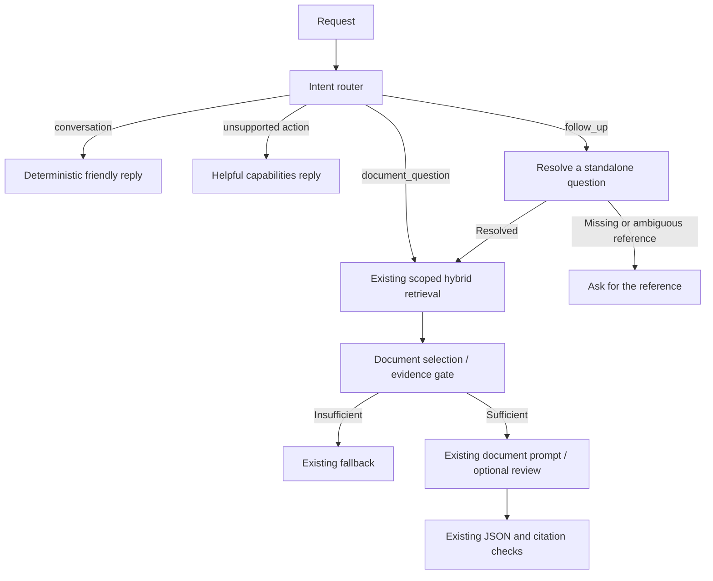

# Conversational upgrade — 12 October 2026

The attached task fits the existing application as a bounded conversation feature
for the trusted local workspace. Its description of a production-oriented backend
does not mean public deployment or authenticated document access already exists.
The local boundary and production fail-closed behavior remain in place.

## Analysis and reused components

Previously, LangGraph began at `retrieve`. Greetings reached embeddings/search and
could produce the insufficient-context answer. The connected UI displayed prior
turns, but the backend received only independent questions. Document selection was
already an English phrase heuristic, with a client resend flow.

The upgrade reuses FastAPI `/v1/chat`, the compiled asynchronous LangGraph,
SQLAlchemy/PostgreSQL, existing embedding/hybrid retrieval, evidence thresholds,
LLM abstraction and configuration, byte/token guards, multipart review, citation
validation, document lifecycle rules, and frontend API adapter. It introduces no
dependency, model/provider selection, credential change, or file deletion.

## Workflow and prompt boundaries



Obvious whole-message greetings, thanks, acknowledgements and capabilities
questions use deterministic responses. Mixed messages such as “Hello, what is
the leave policy?” stay on the document branch. Explicit external actions get a
capabilities reply. Unknown subjects still search documents: a PDF may contain
the requested topic. The router conservatively defaults to document questions
rather than adding a model classification call to every request.

Follow-ups are detected with conservative English patterns. The existing LLM is
called only when a reference needs resolution and the latest non-social turn has
cited sources. Social turns can be skipped; an unsupported or ungrounded completed
turn blocks reuse of an older answer. Only that relevant turn is supplied to the
resolver, even though retention permits several recent turns.

The new resolver system prompt treats history/latest input as untrusted JSON,
forbids answering or changing document access, preserves negations and conditions,
and requires uncertainty to become clarification. Unverified earlier claims must
be framed as something to check. Output is strictly validated JSON with a question
of at most 500 characters, or an explicit ambiguous-reference result. Extra keys,
invalid types, prose, conflicting flags and missing questions fail closed.

`app/prompts/rag.py` is unchanged. Earlier answers never enter its evidence prompt.
A resolved question performs fresh retrieval and uses the original thresholds,
fallback, source metadata and citation-number checks. Explicit document IDs and
`top_k` remain authoritative. With IDs omitted, a follow-up inherits the previous
turn's filter; if that turn searched all documents, it narrows to the documents
actually cited. Retirement/deletion can therefore remove its retrievable evidence.

Passing a citation check means the cited source exists, not that each sentence
is entailed by it. Prompt adherence and reference resolution remain model-dependent.
The new behavior does not establish a “never hallucinate” guarantee.

## Memory and API

`conversation_id` is an optional UUID in `ChatRequest`. A memory-enabled client
also sends a private random hexadecimal capability in `X-Conversation-Key`.
Generate a fresh UUID and a 32-byte random key (64 hexadecimal characters) for a
new chat; retain both for successive turns. The server accepts 32–128 lowercase
hexadecimal characters. The capability is required even for greetings when an
ID is supplied; missing/wrong keys produce 403. The ID alone cannot read history.
Only the key's SHA-256 hash is stored. Keys never enter prompts or routine logs.

The response remains `{"answer": ..., "sources": [...]}` or the existing
`clarification_required` document-choice object. Omitting the ID remains stateless.
Referential ambiguity produces a normal answer asking the user to restate the
reference, with an empty source array. Existing document-choice clarification
preserves `original_question`, `top_k` and filenames/UUIDs.

PostgreSQL stores complete bounded turns, not graph snapshots or source passages.
Short transactions acquire an attempt UUID and a lease of the graph timeout plus
30 seconds. No database connection remains checked out during LLM generation.
Overlapping turns return 409 with `Retry-After: 2`. Attempt fencing prevents a
late response from overwriting a newer owner. Errors/cancellation release ownership;
failed generations and document-choice responses do not append answers to memory.
History survives a backend restart and works across backend instances sharing DB.

LangGraph checkpointing is unnecessary for this scope: memory needs completed
conversation references, without interrupt/resume or persistent internal provider
state. Supplying history through runtime context also keeps the cached graph's
conversations isolated. Public production still requires real identity and
document authorization; capability keys do not replace those controls.

The UI sends credentials automatically, stores a bounded transcript and scope in
tab `sessionStorage`, restores interrupted requests as retryable, and rotates
credentials on Clear chat. Clear chat does not immediately erase old server rows.
Storage unavailable in a browser leaves in-memory conversation usable until reload.

## Configuration and migration

From `Backend`, run `uv run alembic upgrade head` before restarting the API.
Revision `d63a42fbb5fd`, following `c52f31faa4ec`, adds only `chat_conversations`
and its expiry index. Readiness/startup now checks the required conversation columns.
Existing documents, chunks and retained PDFs do not require modification or re-upload.
The migration was applied to the local development database and readiness passed.

| Setting | Default | Purpose |
| --- | --- | --- |
| `CONVERSATION_TTL_SECONDS` | 86400 | Inactivity retention; allowed 300–604800 seconds |
| `CONVERSATION_MAX_TURNS` | 6 | Complete recent turns; allowed 1–20 |
| `CONVERSATION_MAX_HISTORY_BYTES` | 12000 | UTF-8 serialized history; allowed 1000–24000 |
| `CHAT_TIMEOUT_SECONDS` | 180 | Existing graph deadline, including follow-up resolution |

Oversized turns are discarded as complete units rather than summarized into
unsupported facts. Follow-ups may then need a standalone question. Requests
prune up to 100 expired sessions plus their requested expired session. Expired
rows can remain stored until later cleanup; backups retain histories under their
own retention rules. There is no new retention worker or delete-session API.

## Changed components

| File under repository root | Change |
| --- | --- |
| `Backend/app/services/rag.py` | Intent and resolution nodes, runtime history, safe metrics |
| `Backend/app/services/conversation_intent.py` | Deterministic routing/replies, reference-resolution validation |
| `Backend/app/prompts/conversation.py` | Separate resolver system prompt |
| `Backend/app/services/conversations.py` | Claim/run/save/release around graph |
| `Backend/app/storage/conversations.py` | Bounded persistence, expiry, capability verification, fenced claims |
| `Backend/app/storage/models.py` | Conversation model |
| `Backend/migrations/versions/d63a42fbb5fd_add_conversation_memory.py` | Additive migration |
| `Backend/app/schemas/chat.py` | Optional conversation UUID |
| `Backend/app/api/v1/chat.py` | Capability header and 403/409 mappings |
| `Backend/app/api/v1/admin.py` | Existing diagnostic route accepts credentials; routing diagnostics |
| `Backend/app/storage/db.py` | Conversation schema readiness |
| `Backend/app/core/config.py`, `Backend/.env.example` | Retention configuration |
| `Backend/run.py` | Enable application INFO metrics in local launcher |
| `frontend/src/types/backend.ts`, `frontend/src/services/backend.ts` | Compatible request type/header |
| `frontend/src/context/ChatbotContext.tsx` | Credential lifecycle and connected turns |
| `frontend/src/services/chatSession.ts` | Bounded tab persistence |
| `frontend/src/components/chat/ConnectedChat.tsx`, `frontend/src/components/admin/BackendStatus.tsx` | Accurate memory descriptions |
| Backend and frontend tests/docs | Regression coverage and current contracts |

Normal logs contain intent/route, node timings, total graph time, retrieval performed,
result count, error type, fallback category, and available answer/resolver/review
token usage. Existing request metrics supply HTTP latency, including persistence.
No raw questions, answers, passages, keys or conversation IDs are logged by this
workflow metric. Private admin traces still include content and must remain local.
Alternate ASGI launchers must configure the `app` logger at INFO to retain metrics.

## Example requests and responses

These event examples illustrate the contract using fixture content; identifiers
must be replaced with a real document and generated conversation UUID. For the
two memory-enabled examples, send the same private `X-Conversation-Key` header.

Greeting, compatible with existing stateless clients:

```json
{"question":"Hello"}
```

```json
{"answer":"Hello! How can I help you today?","sources":[]}
```

Document question with memory:

```json
{"question":"How do I create an event?","top_k":5,"document_ids":["11111111-1111-4111-8111-111111111111"],"conversation_id":"aaaaaaaa-aaaa-4aaa-8aaa-aaaaaaaaaaaa"}
```

```json
{"answer":"1. Open Events. 2. Select Create. [1]","sources":[{"document_id":"11111111-1111-4111-8111-111111111111","chunk_id":"22222222-2222-4222-8222-222222222222","filename":"events.pdf","page_number":2}]}
```

Follow-up, using the same ID/key and inheriting the prior document scope:

```json
{"question":"Explain the second step again.","top_k":3,"conversation_id":"aaaaaaaa-aaaa-4aaa-8aaa-aaaaaaaaaaaa"}
```

```json
{"answer":"Select Create in Events. [1]","sources":[{"document_id":"11111111-1111-4111-8111-111111111111","chunk_id":"22222222-2222-4222-8222-222222222222","filename":"events.pdf","page_number":2}]}
```

## Validation results

- Backend: **200 passed, 1 skipped, 342 subtests passed**, with `RUN_DB_TESTS=1`
  and `RUN_MODEL_TESTS=1`: `python -m pytest tests -q -p no:cacheprovider`.
  The skipped test is opt-in live-policy evaluation (`RUN_POLICY_TESTS`).
- Includes PostgreSQL history continuity, a new database instance, session isolation,
  malformed/wrong/missing keys, concurrent requests, expired attempts, stale release,
  TTL, bounds, compatible legacy responses, API 403/409 behavior, fresh scoped
  retrieval, no checked-out DB connection during generation, invalid resolver JSON,
  ambiguity, provider timeout, cancellation, safe logging, and existing RAG/error tests.
- Frontend: **22 passed**; TypeScript check and Vite production build passed.
  Covers stable credentials across turns, fresh credentials after clearing,
  transcript restoration/bounds/interrupted requests, plus initial document/chat flows.
- Live local check through port 3000: greeting, policy question, “Explain that
  consequence again”, thanks, citation passage inspection, wrong key rejection,
  and a distinct session's unresolved reference all passed. The document question
  took about 1.17 seconds; resolution plus answer took about 2.30 seconds in this
  single run. Both cited page 47; inspected text supports the probation-extension
  consequence. This is a smoke check, not a quality benchmark.
- Private evidence: `.cache/conversation-evaluation-2026-10-12.json`; no capability
  keys are stored there. Existing 33 imported frontend files remain present.
- Separately ran the opt-in four-case live-policy evaluation. `probation-leave`
  and `approved-leave` passed; `probation-multipart` and `unsupported-question`
  failed with `LLMRateLimitError`, so those two live outcomes are unverified in
  this run. Result: **2 failed subtests, 2 passed subtests** (the parent test also
  reports passed). Traces are in `.cache/policy-evaluation/`. No provider/model
  change or retry loop was introduced to bypass the quota. This separate result
  does not change the 200-test regression-suite result above.
- Rendered browser QA was unavailable because this session has no usable browser
  surface. DOM tests, build and live HTTP checks provide the verification above.

## Remaining limits

Routing is an English heuristic, not general multilingual intent understanding.
Reference resolution considers the latest grounded topic, not arbitrary earlier
topics, and adds one provider call before RAG. Some unrecognized follow-up forms
can default to ordinary retrieval; users can restate a standalone question.
Retries after other completed turns use the current history, so a contextual retry
may require restating its referent. Failed requests retain the last completed
history. Bounded memory and expiry can lose earlier references.

Model output can still misresolve a referent or infer an unsupported relationship.
The live answers supported the tested consequence but did not follow every prompt
formatting instruction, such as short decisive quotations. Citation checks and
the existing evidence heuristic cannot prove factual entailment. Corpus-specific
evaluation and the earlier architecture audit remain applicable.

This is a local single-operator feature. It does not add public hosting, user
accounts, tenant/document authorization, browser XSS protection beyond existing
text rendering, encryption of history at rest, chat streaming, external tools,
or immediate erasure of retained conversations/backups. Preserve the local boundary
until deployment-specific authentication and document access controls exist.
