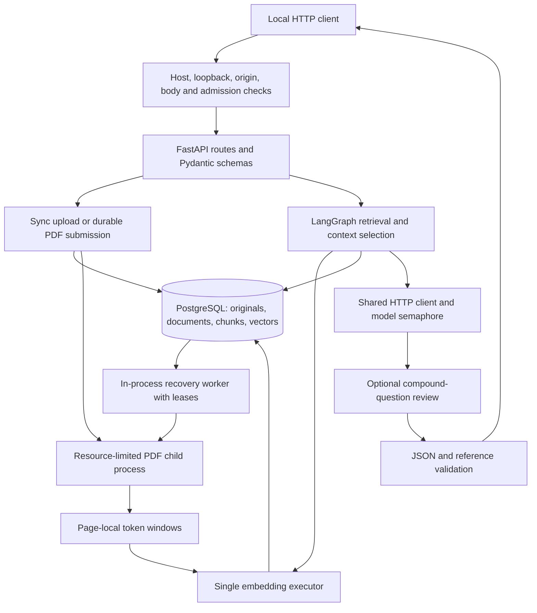

# Endpoint and architecture audit — 12 October 2026

The backend is functional for its supported local, single-operator use, but it
has reproducible boundary and configuration bugs. Passing the current test suite
does not establish comprehensive endpoint correctness or reliable policy interpretation.
This audit changed no application source and did not upload, retire, or delete
existing user documents.

## Scope and evidence

- Reviewed all **16 OpenAPI API operations**, middleware, lifecycle, ingestion,
  recovery, embeddings, storage, retrieval, generation, and draft review.
- Exercised 44 HTTP cases against the running API, including utility routes,
  normal reads, validation, missing resources, access checks, invalid uploads,
  source downloads, search, fallback chat, and authenticated diagnostics.
  Four unexpected responses were reproduced: two trailing-slash upload paths,
  a non-ASCII admin token, and a malformed Host value. A connection read error
  immediately following the 500 was retested with a fresh connection; the
  cross-origin rejection itself correctly returned 403.
- Successful mutations were checked by the isolated PostgreSQL integration
  suite, rather than changing the user's stored documents. The full suite,
  including cached real embeddings, returned **184 passed, 1 skipped,
  337 subtests passed**. The skipped suite is the separately opt-in live policy test.
- Ran a fresh real-provider compound question through `/v1/chat`. It returned
  200 and references but still interpreted the relationship between policy
  provisions more strongly than the evidence establishes. Its response is in
  `.cache/endpoint-audit/live-chat.json`.
- Used isolated configuration and dependency-failure probes to reproduce
  negative prompt budgets, permanently false readiness, storage-timeout
  mappings, pre-claim recovery retries, and review-context overflow.
- No corpus-scale performance benchmark, provider outage, real process crash,
  distributed deployment, or public authentication test is claimed.

## Endpoint inventory

| Operation | Evidence / current result | Main concern |
| --- | --- | --- |
| `GET /v1/health` | Live 200 | Liveness only; expected |
| `GET /v1/ready` | Live 200; isolated no-warmup configuration yields 503 | D05; does not verify model availability |
| `POST /v1/documents/upload` | Live missing/invalid input checks; isolated success/duplicate/retry tests | D02; synchronous processing waits on parser/embeddings |
| `POST /v1/documents/jobs` | Live validation; isolated durable submission/recovery tests | D02, D06; limited status/error reporting |
| `GET /v1/documents/jobs/{id}` | Live 200/404; injected timeout gives 500 | D06 |
| `GET /v1/documents` | Live 200/422; pagination/filter integration tests | Offset/count scaling; total/items use different READ COMMITTED snapshots |
| `GET /v1/documents/{id}` | Live 200/404 | Local-only access; no ownership model |
| `GET /v1/documents/{id}/source` | Live 200 and expected legacy 409 | Two current documents lack retained originals |
| `GET /v1/documents/{id}/chunks/{chunk_id}` | Live 200/404; mismatched-ID integration test | No public authorization model; local scope only |
| `POST /v1/documents/search` | Live 200, selected-ID empty result | Heuristic relevance, exact-vector scaling |
| `POST /v1/chat` | Live 200/422 and fallback; actual model call | D01, D04, D08; no claim-level support proof |
| `PATCH /v1/documents/{id}/activation` | Live 404/422; isolated valid activation | D06; no public authentication |
| `DELETE /v1/documents/{id}` | Live missing-ID 404; isolated cascade deletion | D06; no public authentication |
| `GET /v1/admin/status` | Live 403/200; malformed token gives 500 | D03; status describes configuration rather than model usability |
| `GET /v1/admin/documents` | Live 403/200 | D03; dependency maps DB errors to 500 |
| `POST /v1/admin/chat` | Live authenticated fallback; shared chat code | D01/D03/D08; success/error envelope differs from normal chat |

Utility routes `/`, `/admin`, `/admin-assets/app.js`, `/docs`, `/redoc`, and
`/openapi.json` responded as expected. Access checks apply to those routes too.

## Confirmed defects and evidence-backed flaws

### D01 — High: valid citations and draft review do not establish factual support

[Answer validation](../Backend/app/services/rag.py#L138) checks JSON and source indexes;
it does not check whether each claim follows from its cited passage. Citation
numbers are appended to the whole answer, not linked to individual claims.
The same generator also reviews the draft, which is a correlated check rather
than an independent correctness guarantee.

The fresh compound-question response states both that approved leave extends
probation and that the policy does not provide a manager-approved exception.
The passages establish a restriction and a separate approved-leave consequence;
they do not resolve precedence. That interpretation should be presented as
uncertain, rather than an established absence of an exception.

**Action:** Evaluate claim support and completeness on a larger labeled corpus;
return an explicit ambiguity answer when clauses do not resolve precedence.
Use per-claim evidence or validated excerpts, and test reviewer failures with
realistic contradictory drafts. Do not treat the four earlier passing examples
as a factual-quality certification.

### D02 — Medium: trailing-slash uploads receive the 32 KiB JSON limit

[Middleware upload detection](../Backend/app/core/middleware.py#L37) uses literal path
suffixes. `/v1/documents/upload/` and `/v1/documents/jobs/` are misclassified.
40 KB requests returned **413** before FastAPI could redirect, while the same
invalid bytes at canonical paths reached validation and returned **422**.

**Action:** Normalize the path before selecting upload limits and admission,
then test canonical/slash forms with both Content-Length and streamed bodies.

### D03 — Medium: malformed admin tokens crash authentication

[Token comparison](../Backend/app/core/local_access.py#L26) passes strings to
`secrets.compare_digest`. A header containing byte `0xff` is decoded to a
non-ASCII string; comparison raises `TypeError`. Live `/v1/admin/status` returned
**500, plain text**, instead of 403. All admin routes share this dependency.

**Action:** Reject non-ASCII tokens explicitly or compare safely encoded bytes.
Ensure malformed authentication input always returns the normal 403 contract.

### D04 — High configuration defect: accepted settings silently empty all context

[Context budgeting](../Backend/app/services/rag.py#L267) subtracts output reserve and
512 framing tokens, but configuration has no cross-field validation. A valid
`RAG_CONTEXT_WINDOW_TOKENS=4096` with the default reserve 4096 produces a
**-512-byte** budget. An isolated relevant-context probe selected no chunks and
reported insufficient evidence. Requests can therefore return an apparently
legitimate fallback instead of identifying a broken configuration.

**Action:** Validate the combined window, output reserve, actual generation
output cap, and minimum prompt size at startup. Distinguish budget exhaustion
from absence of evidence.

### D05 — Medium configuration defect: disabling warmup makes readiness false forever

[Startup](../Backend/app/main.py#L35) initializes `embedding_ready=False` and sets it
true only during startup warmup. Setting the exposed option
`EMBEDDING_WARMUP_ON_STARTUP=false` leaves the flag false even if subsequent
queries load the model. A database-ready isolated app returned **503**.

**Action:** Either require warmup for this deployment or update/read real
provider readiness after successful lazy initialization.

### D06 — Medium: inconsistent storage failure and error-body contracts

[Jobs](../Backend/app/api/v1/jobs.py#L57) and
[lifecycle](../Backend/app/api/v1/document_lifecycle.py#L26) catch SQLAlchemy errors but
not `TimeoutError`. Injecting that error into the storage boundary yielded
**500/plain text** for job polling, activation, and deletion; catalog returned
**503/JSON** for the same injected failure. Chat separately maps storage errors
to 500. This was a dependency-injection probe, not an observed live DB outage.

**Action:** Centralize temporary-storage failure mapping and a consistent JSON
error envelope. Keep validation, unknown resources, provider failures, and
temporary outages distinct.

### D07 — Medium: failures before an ingestion claim evade recovery attempt limits

[Extraction occurs before the fenced claim](../Backend/app/services/ingestion.py#L103).
[Recovery](../Backend/app/services/recovery.py#L32) only converts PDFExtractionError to
failed; unexpected process-creation/dependency errors escape. The worker then
reselects the oldest pending document. A three-error injection probe performed
only SELECTs and left its attempt count at zero. A persistent pre-claim error
can retry indefinitely and starve later queued work.

**Action:** Count durable processing attempts before parsing, record a safe
failure reason and retry schedule, and ensure one repeatedly failing job cannot
block the queue. Preserve attempt fencing around publication.

### D08 — Medium: the review call is absent from context selection budgeting

[Review](../Backend/app/services/rag.py#L332) appends the draft and additional system
instructions to a prompt already sized for generation. An isolated probe with
a **23,254-byte** first prompt and a permitted long draft made one successful
mock provider call; the review was rejected before its call because it exceeded
the 32,768-token configured conservative budget. The user gets a 502 even though
generation succeeded. The guard prevents overflow but selection does not reserve
review capacity.

**Action:** Reserve review input and output capacity before selecting passages,
or budget both stages independently and fail with a clear size/configuration error.

### D09 — Low: malformed Host authorities pass the loopback hostname check

[Host parsing](../Backend/app/core/local_access.py#L14) extracts only `.hostname`.
The live header `Host: attacker@localhost` was accepted with **200**. Userinfo
is invalid for a Host authority. The socket must still be loopback, so this
probe does **not** establish remote access or an authentication bypass.

**Action:** Validate the entire Host authority, reject userinfo/path/query/fragment
components, and validate its port.

### D10 — Low: boundary errors bypass correlation headers and timing logs

[Early middleware returns](../Backend/app/core/middleware.py#L29) occur before the
response decorator and logging `finally`. Reproduced foreign-origin/host and
oversized-body responses lacked `X-Request-ID` and `Cache-Control: no-store`.
Some bodies include a request ID, others do not. There is also no repository
root logging configuration enabling the middleware's INFO timing logger in the
default launcher; Uvicorn access logs are a separate mechanism.

**Action:** Apply shared response decoration and structured logging to accepted,
rejected, and unhandled-error paths. Configure the application logger explicitly.

### D11 — Low: OpenAPI omits real success/error variants

Job submission documents 202/422 although ready duplicates return 200. Catalog,
source, job, and lifecycle operations omit implemented 404/409/503 variants.
Admin routes do not describe their 403 dependency responses; most routes omit
middleware 403/413/429 behavior. A generated client will have an incomplete
contract. Clarification also caps choices at 50 without signaling truncation.

**Action:** Document actual response variants and common errors, type job status
as the allowed enum, and make truncated clarification lists explicit or paginated.

## Architecture assessment

The separation of services/providers/storage is useful. Hash uniqueness,
attempt fencing, atomic chunk publication, original-source retention, parser
process isolation, normalized vectors, scoped model transport, and short
retrieval transactions provide real integrity protections. Generation happens
after chat releases its read transaction. SQL parameters are bound.

Additional architectural limits:

1. **Local trust boundary, not authentication:** Normal API routes, including
   deletion and source retrieval, require no operator token or ownership check.
   This is consistent with the current trusted-local scope. Multi-user/public
   deployment requires authenticated principals, document authorization,
   ingress controls, and an approved frontend-origin contract first. Production
   mode currently fails closed.
2. **One-process capacity:** Request admission and model semaphores are in
   memory. Only POST is admitted; GET downloads/catalog and PATCH/DELETE can
   exhaust the DB pool outside that gate. The background worker does not share
   upload admission. These limits do not constitute distributed quotas.
3. **Native inference cannot be killed:** Eight outstanding embedding jobs are
   bounded, but one hung native inference can block all queued embeddings after
   callers time out. The startup-ready flag does not detect that degraded state.
4. **Retrieval is not evidence completeness:** RRF uses a small candidate set,
   exact vector scans, English lexical matching, and a weak evidence heuristic.
   Fixed token windows can split policy clauses; overlapping same-page chunks
   can consume several top-k slots. There is no neighbor expansion, clause-aware
   deduplication, measured recall target, or claim-level grounding check.
5. **Storage and pagination scaling are unmeasured:** Originals live in the DB,
   source downloads materialize the full PDF, catalog uses count plus correlated
   chunk counts, and deep offsets become expensive. Different statements can
   observe different snapshots during concurrent mutation. These are scaling
   risks, not failures demonstrated at the current three-document corpus.
6. **Jobs expose little diagnostic state:** Clients get pending/ready/failed but
   no failure code, last error, retry schedule, stage, or recovery-worker health.
   A frontend can poll but cannot explain a failed or stuck job.
7. **Readiness excludes the LLM:** A ready API may still have a bad provider
   configuration, quota exhaustion, or unavailable model. This is documented,
   but frontend diagnostics should distinguish these dependency states.
8. **Legacy source gaps:** Live metadata reports missing original PDFs for two
   documents. Stored citations remain accessible, but download/reprocessing
   requires re-uploading exact originals. This is data history, not a new
   download-endpoint malfunction.

## Recommended order

1. Fix malformed-token handling, upload path classification, configuration
   validation, readiness, and consistent failure mapping; add regression tests.
2. Fix pre-claim recovery accounting and review budgeting; expose safe job
   failure/retry information.
3. Establish a broader factual-quality gate, ambiguity behavior, complete-clause
   retrieval, and measured upload/chat capacity.
4. Align OpenAPI and frontend error handling, citation inspection, polling, and
   same-origin/proxy behavior.
5. Add public authentication/ownership and deployment infrastructure only if
   the product moves beyond its current local scope.

The earlier readiness report is an integration baseline, not a statement that
these defects are absent. Application fixes were deliberately left for a
separate implementation pass so this audit remains reviewable.
