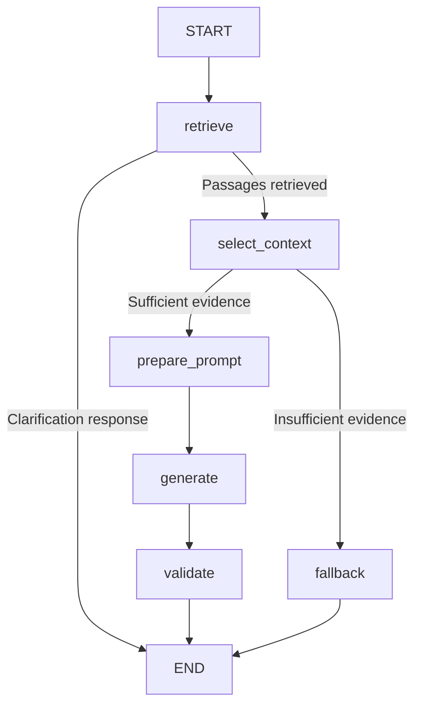

# LangGraph chat workflow

`app/services/rag.py` builds a cached, compiled `StateGraph` and invokes it
asynchronously for each chat request. Each invocation gets independent state.
The SQLAlchemy session and optional diagnostic trace are supplied through runtime
context, not stored as graph state or shared between requests.

The retrieval node resolves document selection and runs the existing hybrid
search inside one read transaction. That transaction closes before later nodes,
including generation. Ingestion, chunking, embeddings, database tables, and
Groq request settings are reused. API response schemas and error mappings are
unchanged. Exceptions and cancellation propagate without graph retries.

The generation node calls `generate_llm_response`, which creates LangChain
`SystemMessage`/`HumanMessage` inputs and invokes `CompatibleChatModel.ainvoke`.
This custom `langchain-core` adapter delegates to the validated HTTP transport;
it does not add a provider SDK, retries, caching, tools, or provider streaming.
It can compose with LangChain Runnable components and accept callbacks. The
RAG service still validates structured JSON and source references after generation.

Traces keep their existing fields and add `workflow_steps`, listing entered nodes
even when a node fails. Traces contain private passages; keep them local.

This migration is stateless. It does not add conversation memory, checkpoint
storage, interrupt/resume sessions, streaming, or additional LLM calls. Document
selection continues to use the client's resend flow described in
[document-selection.md](document-selection.md).

After pulling these changes, run `uv sync`, restart the backend, and use the
same `/v1/chat` requests. No re-upload or database migration is required.

Reference: https://docs.langchain.com/oss/python/langgraph/graph-api
