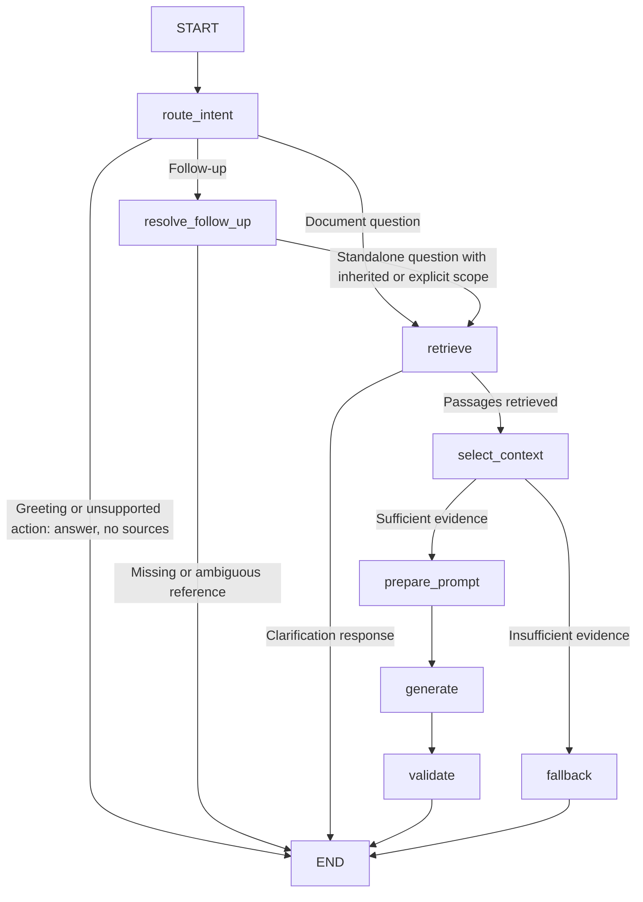

# LangGraph chat workflow

Run backend commands from the repository's `Backend` directory. Shared caches and backups remain under the repository-root `.cache`.

`app/services/rag.py` builds a cached, compiled `StateGraph` and invokes it
asynchronously for each chat request. Each invocation gets independent state.
The SQLAlchemy session and optional diagnostic trace are supplied through runtime
context, not stored as graph state or shared between requests.

The retrieval node resolves document selection and runs the existing hybrid
search inside one read transaction. That transaction closes before later nodes,
including generation. Ingestion, chunking, embeddings, database tables, and
Groq request settings are reused. API response schemas and error mappings are
unchanged. Exceptions and cancellation propagate without graph retries.

The generation node calls `generate_llm_response`, which creates LangChain
`SystemMessage`/`HumanMessage` inputs and invokes `CompatibleChatModel.ainvoke`.
This custom `langchain-core` adapter delegates to the validated HTTP transport;
it does not add a provider SDK, retries, caching, tools, or provider streaming.
It can compose with LangChain Runnable components and accept callbacks. The
RAG service still validates structured JSON and source references after generation.
For compound questions containing `and`, `also`, or multiple question parts,
the generation node validates the draft references and makes one review call
against the original passages. The corrected response then goes through normal
validation. The draft and review diagnostics remain in `draft_answer` and
`answer_review`. Review failure propagates; the draft is not returned. Disable
this behavior with `RAG_REVIEW_MULTIPART_ANSWERS=false` when evaluating its cost
and quality tradeoff. Review is a model-based check, not proof of entailment.

Traces keep their existing fields and add `workflow_steps`, listing entered nodes
even when a node fails. Traces contain private passages; keep them local.

Conversation memory is optional. The session service supplies bounded completed
turns through runtime context; the cached graph has no shared conversational state.
Greetings and explicit unsupported actions use deterministic replies without
embeddings, retrieval, or LLM calls. Follow-ups use the existing model to resolve a
standalone question. Only the latest non-social, grounded turn can provide the
reference; old answers never enter the RAG evidence prompt. Missing or ambiguous
references request clarification. All document answers use fresh retrieval and the
original evidence gate, prompt, and citation checks.

Completed turns are persisted separately in PostgreSQL, protected by a private
conversation capability key and short fenced claims. Graph checkpoint storage is
not required: this application needs conversational references, not durable internal
generation snapshots or interrupt/resume. No new dependency is introduced. See
[the implementation report](conversational-upgrade-2026-10-12.md) for retention,
concurrency, API examples, and limitations. Document selection continues to use
the client's resend flow described in [document-selection.md](document-selection.md).

Apply `uv run alembic upgrade head` before restarting the backend. The new revision
is `d63a42fbb5fd`. No document re-upload is required. Existing `/v1/chat` clients
can continue omitting conversation credentials and use stateless requests.

Reference: https://docs.langchain.com/oss/python/langgraph/graph-api
