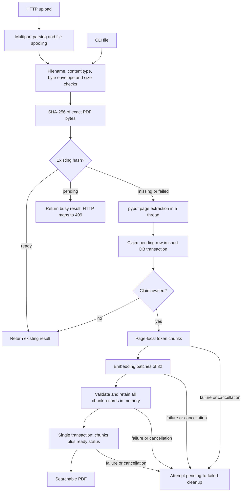
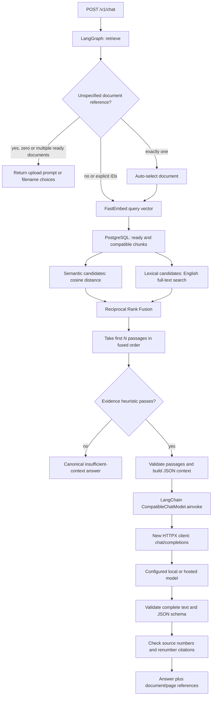
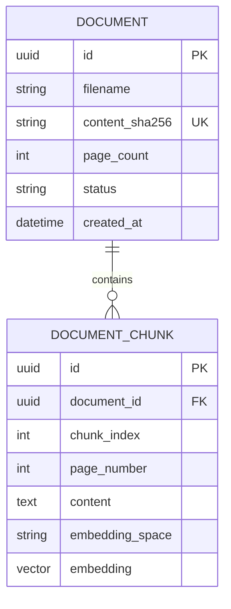
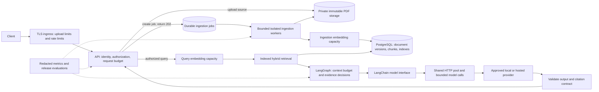
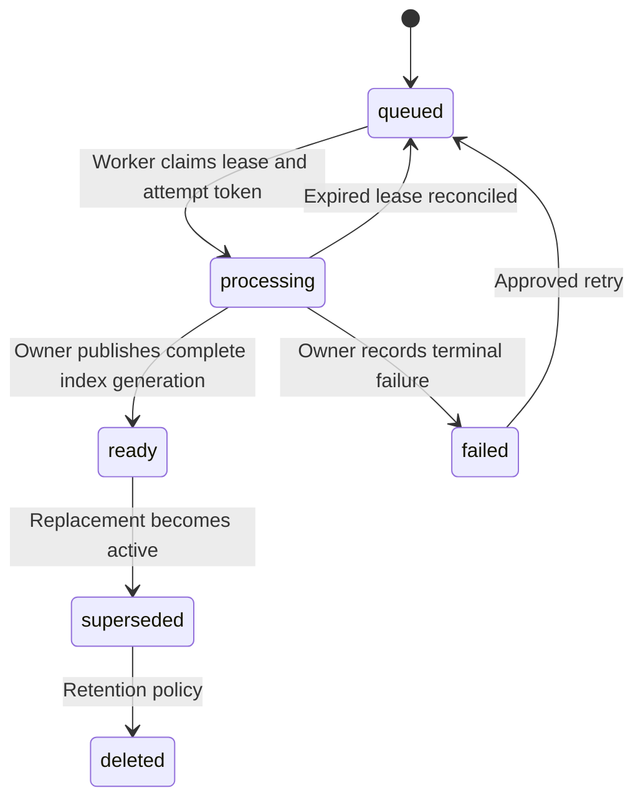

# RAG architecture and production review

**Review date:** 9 October 2026, Asia/Kolkata  
**Original scope:** Working-tree code, dependencies, tests, configuration, migrations, and deployment files at the initial review.  
**Original change boundary:** The initial audit only created this report. The remediation below subsequently changed application code, tests, deployment files, documentation, and the local database schema.

## 0. Remediation status — 9 October 2026

Sections 1–11 retain the original audit for traceability. This status table takes
precedence when describing the current system. The supported release is a
single-operator, loopback-only workspace. It is not a public multi-tenant service.

| Finding | Current implementation | Remaining boundary or evidence |
|---|---|---|
| R01 | Loopback client/Host checks, same-origin restriction, local admin token; public production mode fails closed | User/tenant authentication and document authorization remain required for public exposure |
| R02 | Content-Length and streamed body limits before parsing; reception deadline and one active upload | Verify any future proxy's independent ingress contract |
| R03 | Durable 202 submission/status API; retained-source worker; parser process with memory/deadline limits; bounded chunks and ingestion deadline | Synchronous upload retained for compatibility; native embedding execution cannot be forcibly killed |
| R04 | Attempt tokens, renewable leases, automatic expired-attempt recovery, cancellation release, three-attempt ceiling | Legacy documents without retained sources need re-upload; failures require explicit retry |
| R05 | Bounded executor queue, embedding deadlines and request/upload admission | Measured mixed-workload capacity remains required |
| R06 | GIN full-text index, matching literal SQL expression, semantic rank assigned after candidate limiting | Exact vector search retained; ANN choice and recall/latency benchmarks remain open |
| R07 | Prompt byte budget plus conservative token upper bound, output reserve and model context-window check | Configure the actual served model window; assumption applies to byte-level tokenizers |
| R08 | Shared HTTP lifecycle, limited connections, generation semaphore, request/model deadlines | Limits apply to the supported single process; distributed quotas require additional infrastructure |
| R09 | Reference validation, evidence heuristic and trusted prompt remain | Factual entailment is not proven; corpus-specific support review remains a release gate |
| R10 | CI for isolated PostgreSQL tests, migrations, unit checks and locked image build; new recovery/boundary tests | CI execution and broader labeled live-answer evaluation remain required |
| R11 | Retained PDFs, processing provenance, explicit retirement/reactivation and cascade deletion | Legacy source backfill and automatic policy-version relationships are not implemented |
| R12 | Schema-aware startup, pinned embedding warmup/readiness, non-root image, backup/restore tools and operations guide | Linux host-network container deployment; hosted LLM usability checked separately; monitoring/restore scheduling belongs to deployment |
| R13 | Model identity and verified usage/finish metadata in adapter responses; stage/queue traces; safe request timing logs | External metric aggregation and alerting still need deployment configuration |
| R14 | Document selection ends its transaction before embedding | Regression coverage retained |
| R15 | Search-query/body limits, bounded clarification list, paginated admin document list | Public authorization/error contracts remain outside the local scope |
| R16 | English searchable-text PDF scope documented; missing-text page metadata retained | OCR, full-document summaries, multilingual/layout extraction and conversation memory remain optional product work |
| R17 | Tokenizer and ONNX model pinned to cached immutable revisions; package/pipeline/chunk provenance retained | Changing the embedding space still requires an evaluated reindex/migration plan |
| R18 | Local-only diagnostics, no-store responses, safe logging, private POSIX trace creation, trace-expiry tool, document deletion | Windows ACLs, encrypted off-machine backups, provider approval and scheduled retention require operator configuration |
| R19 | README, environment sample, migration head and operations guide aligned | APP_ENV=production explicitly rejects unsupported public deployment |
| R20 | Only structured source_numbers supply citations; ordinary numeric brackets remain literal | Citation support still requires semantic evaluation |

Applied schema head: `c52f31faa4ec`. Recovery and lifecycle details are in
[operations.md](operations.md). The original PDF export remains an initial-audit snapshot.

### Remediation verification

- Full suite with PostgreSQL and cached real embeddings: **180 passed, 1 skipped,
  337 subtests passed**. The skip is the live policy/LLM evaluation.
- Local schema migrations applied through `c52f31faa4ec`; `alembic check` reports
  no new upgrade operations.
- Lockfile consistency and Compose configuration checks passed.
- Locked non-root Docker image build passed. A temporary Linux container
  successfully extracted a generated PDF under the process resource limits as
  a non-root user. Public hosting is not enabled.
- Native startup, pinned embedding warmup, health, readiness and admin smoke checks passed.
- Backup restored into a separate new database, `restore_review_20261009`.
  Its schema, retained source hashes, document identities and document/chunk
  counts matched the source database. The original database was not overwritten.
- No live LLM factual-quality evaluation, corpus-scale load benchmark, deployed
  CI run, public tenant test, or off-machine disaster recovery exercise is claimed.

The local backup is under `.cache/backups`; the restore-drill database and Docker
image are retained for inspection. Changes remain uncommitted.

## 1. Assessment

The application is a **stateless PDF question-answering backend for a shared corpus**. It has explicit ingestion transactions, hybrid retrieval, a LangGraph workflow, and a custom LangChain model interface.

It is **not ready to expose confidential documents to untrusted users or serve an agreed production workload without further work**. The release blockers are document access control, durable ingestion recovery, resource limits, and a verified deployment/evaluation process. The actual request capacity and answer accuracy are unknown.

| Area | Current assessment | Reason |
|---|---|---|
| Code separation | Clear responsibilities | API, services, providers, schemas, prompts, and storage are separate. |
| Data integrity | Several useful protections | Unique hashes, conditional claims, vector validation, atomic ready publication. |
| Confidential multi-user access | Release blocker | No authenticated principal, tenant/owner schema, or authorization filters. |
| Crash recovery | Release blocker | A committed pending row can remain pending indefinitely. |
| Traffic handling | Unverified; visible bottlenecks | Request-bound ingestion, serialized embeddings, unindexed search, no admission control. |
| Answer quality | Unverified | Output validation is stronger than semantic evaluation; three live evaluation cases. |
| Deployment and operations | Incomplete in this repository | Empty Dockerfile, database-only Compose, no CI or restore evidence. |
| LangChain integration | Small, valid interface adapter | It preserves HTTP behavior; it does not add production infrastructure or provider capabilities. |

**Priority meanings:** P0 = resolve before the stated exposure scenario; P1 = resolve before a production release under relevant load or document requirements; P2 = reliability, product-scope, or maintainability improvement. A missing feature is not automatically a defect: OCR, conversation memory, and streaming depend on the product you intend to offer.

### Evidence and limits

- Active Python files were inspected across the team; this report includes a file inventory below.
- A read-only AST syntax check passed for **57 Python files**. This establishes parsable syntax, not correct runtime behavior.
- No application imports, database migrations, model downloads, test executions, production requests, or load tests were performed during this review.
- Existing tests were reviewed as evidence of intended coverage. Their current pass status and coverage percentage were not established in this audit.
- No secret values were read from `.env`. Generated PDFs/images, vendored temporary artifacts, and cached models were not treated as application source.
- Severity assumes documents may be private and users may not share access to the same corpus. A verified authentication gateway can reduce exposure, but does not itself supply document authorization.
- Recommendations below are proposals, not implemented changes or claims of production readiness.

## 2. Current project tree

```text
ai-chatbot/
├── app/
│   ├── main.py                    API construction and DB lifespan
│   ├── api/v1/                    upload, search, chat, health, readiness
│   ├── core/config.py             DB, embedding, and RAG settings
│   ├── schemas/                   request/response and ingestion contracts
│   ├── providers/
│   │   ├── documents.py           PDF text extraction
│   │   ├── base.py                embedding interface
│   │   ├── embeddings.py          provider selection
│   │   ├── fastembed_provider.py  local inference, one process-wide lock
│   │   └── chat_model.py          custom LangChain async adapter
│   ├── services/
│   │   ├── document_hash.py       duplicate identity
│   │   ├── chunking.py            page-local token windows
│   │   ├── ingestion.py           reserve, process, publish
│   │   ├── retrieval.py           query embedding and evidence heuristic
│   │   ├── rag.py                 LangGraph request workflow
│   │   └── llm.py                 validated HTTP generation
│   ├── prompts/rag.py             trusted answer rules
│   └── storage/                   connection pool, tables, hybrid SQL
├── migrations/                    one initial schema revision
├── infra/postgres/init/            vector extension initialization
├── scripts/                       CLI ingestion and private RAG traces
├── evaluation/questions.json      three policy questions
├── tests/                         unit, mocked integration, opt-in live tests
├── docs/                          workflow and client-selection documentation
├── run.py                         local Uvicorn launcher
├── compose.yaml                   PostgreSQL service only
├── Dockerfile                     empty
├── pyproject.toml / uv.lock        dependencies and resolved versions
└── .env.example                   sample configuration
```

Empty placeholders are `app/providers/models.py`, `app/services/chat.py`, and `app/storage/vector_store.py`. Their filenames do not represent implemented components. Package `__init__.py` files contain no application logic.

## 3. Current architecture and full lifecycle

### 3.1 Ingestion



The endpoint waits for the whole pipeline. Moving extraction/inference to threads keeps those operations off the event loop; it does **not** create a durable background job.

A ready document and all its chunks become visible together. No normal reader sees half of a published ingestion. Parsing happens before the exclusive claim, so concurrent first uploads can both parse the same PDF.

### 3.2 Query and answer



**Transaction boundary:** The read transaction ends before generation. One exception to the intended short DB use occurs when document selection executes a SELECT, auto-selects one document, and then waits for its embedding inside the same transaction. Ordinary requests have not necessarily checked out a DB connection at the start of `db.begin()`.

**Trust boundary:** Passage text and filenames are untrusted model input. JSON encoding and the system prompt make the intended rules clearer. They do not prove the model will obey them. This implementation has no tool execution path, which limits the consequences of model-generated tool requests.

**Provider boundary:** A hosted LLM receives the question and selected passages. Local embeddings do not make hosted generation local or private.

### 3.3 Stored data



The schema stores extracted text and 384-dimensional vectors. It does not store the original PDF, owner/tenant, active document version, extraction version, job lease, or attempt identity.

## 4. Components and keywords

| Component or term | Brief meaning | Actual use here |
|---|---|---|
| RAG | Retrieve source material before generating an answer | PDF passages enter the model prompt. |
| FastAPI | Python HTTP API framework | Validates requests and returns typed responses. |
| Pydantic | Data validation | Checks filenames, questions, chunks, and model answer shape. |
| pypdf | PDF parser and text extractor | Extracts selectable text per page; no OCR. |
| Chunk | A bounded passage used for indexing | 350 BGE tokens with 40-token page-local overlap. |
| Embedding | Numerical representation of text | BGE-small-en-v1.5, 384 values, normalized to unit length. |
| FastEmbed / ONNX Runtime | Local embedding inference | CPU work runs in threads behind a shared lock. |
| PostgreSQL | Relational database | Documents, chunks, state transitions, lexical search. |
| pgvector | PostgreSQL vector support | Cosine distance over stored embeddings. Python adapter and server extension are separate dependencies. |
| SQLAlchemy / Psycopg | SQL construction and database driver | Async sessions, connection pooling, transactions. |
| Alembic | Schema migration tool | Creates the two application tables. |
| Cosine distance | Vector separation; lower is closer | Semantic ranking and an evidence threshold; not a confidence probability. |
| Lexeme | Normalized word used by full-text search | English stemming/stop-word rules produce query and match terms. |
| RRF | Combines lists using reciprocal ranking positions | Fuses semantic and lexical candidates; `RRF_K=60`. |
| LangGraph | Explicit state/nodes/branches | Orchestrates one stateless request. |
| LangChain Core | Standard model and Runnable interfaces | Custom async model wraps the existing transport. |
| HTTPX | Async outgoing HTTP client | Sends generation requests and enforces network timeouts. |
| Idempotency | Repeating a request avoids duplicate effects | Exact-byte PDF hash plus DB claim/duplicate logic. |
| Lease / fencing | Temporary job ownership plus stale-attempt rejection | Proposed recovery mechanism; currently absent. |
| OCR | Recognition of text inside images | Currently absent. |
| HNSW / GIN | Approximate vector / full-text index types | Potential search improvements; neither is present. |

### Dependency snapshot from uv.lock

| Group | Resolved packages |
|---|---|
| API and validation | FastAPI 0.141.1; Starlette 1.7.0; Pydantic 2.13.5; pydantic-settings 2.15.0; python-multipart 0.0.32; Uvicorn 0.53.0 |
| RAG interfaces | langgraph 1.2.14; langchain-core 1.6.7 |
| Parsing and embeddings | pypdf 6.19.0; FastEmbed 0.8.1; ONNX Runtime 1.30.0; tokenizers 0.23.2; huggingface-hub 1.33.0 |
| Database | SQLAlchemy 2.0.54; Psycopg 3.3.6; Python pgvector 0.5.0; Alembic 1.20.0 |
| Transport and tests | HTTPX 0.28.1; pytest 9.1.1 |
| Runtime and database image | Python requires >=3.12; Compose names pgvector/pgvector:0.8.6-pg16-trixie |

The lockfile supports repeatable package installation when deployed with a locked install. No vulnerability scan, model-asset provenance audit, license audit, or deployment-image build was performed. The Python pgvector package version is not the database extension version.

## 5. Existing controls and their limits

| Setting/control | Current value or behavior | What it does not establish |
|---|---|---|
| Accepted PDF size | 10 MiB | A pre-multipart network upload limit or parser memory ceiling |
| Maximum PDF pages/text | 100 pages; 2,000,000 extracted characters | Bounded work before page extraction completes |
| Maximum chunks | 1,000 per document | Early stopping while all chunks are being constructed |
| Chunking | 350 tokens; overlap 40; max encoded length 480 | Generation model token budget or whole-document understanding |
| Embedding batch | 32 | Concurrent query/ingestion isolation |
| DB insert batch | Up to 256 records per execute | Multiple independently published partial documents; publication is one transaction |
| Query results | `top_k=5`, permitted 1–20 | Retrieval recall or complete document coverage |
| Prompt passages | Default 5, permitted 1–20 | A model-aware input-token bound |
| Evidence threshold | Cosine distance <=0.45, or lexical-match rule | Semantic entailment, calibrated confidence, or correctness |
| Chat question | At most 500 characters | A body-size limit before JSON parsing |
| Document search query | No maximum length | Bounded embedding/full-text processing cost |
| Generation | Temperature 0; max_tokens 300 | Determinism, factual correctness, or sufficient output space |
| GPT-OSS exceptions | Two exact model names get 2,048 tokens and low reasoning effort | General provider capability detection |
| Model request timeout | 30-second default; configurable >0 to 600 | End-to-end retrieval, executor queue, or upload deadline |
| Connection timeout | 5 seconds | Provider availability under load |
| DB pool | Default 5 connections, no overflow, 5-second pool wait | An API request/concurrency limit |
| DB statement timeout | Default 5,000 ms per statement | A total transaction or request deadline |

## 6. Findings and proposed remedies

The cited lines refer to the inspected working tree. Links open source files; line numbers identify the relevant code.

### R01 — P0: No document access boundary for untrusted users

**Confirmed:** Router/app construction has no auth dependency or auth middleware. The schema has no owner/tenant. Unfiltered queries search all ready documents, search responses include passage text, and clarification lists all ready filenames.

**Failure scenario:** A reachable unauthenticated caller can search a private corpus. Adding login alone still permits cross-user documents unless ownership is enforced.

**Proposal:** Establish authenticated identity; enforce allowed tenant/document scope in every list, claim, search, and source lookup. Scope hash uniqueness to the correct ownership model. Test forged IDs and cross-tenant searches. Database row-level security can provide an additional boundary if designed and tested.

**Evidence:** [main.py:31](../Backend/app/main.py), [router.py:8](../Backend/app/api/v1/router.py), [models.py:35](../Backend/app/storage/models.py), [storage/documents.py:324](../Backend/app/storage/documents.py), [rag.py:218](../Backend/app/services/rag.py), [api/documents.py:222](../Backend/app/api/v1/documents.py).

### R02 — P1: The 10 MiB check happens after multipart reception

**Confirmed in application and installed framework:** FastAPI reads the form before calling the upload route. File parts can spool to temporary storage. The endpoint's bounded reader protects extraction input, but it cannot undo the already received/spooled request.

**Failure scenario:** Oversized or repeated multipart files consume bandwidth and temporary disk before the API returns 413.

**Proposal:** Bound total streamed request bytes, part counts, and upload duration before form parsing, at a verified ingress/ASGI boundary. A Content-Length check alone is insufficient for streaming requests.

**Evidence:** [api/documents.py:44](../Backend/app/api/v1/documents.py), [main.py:31](../Backend/app/main.py); installed FastAPI `routing.py:428–431` and Starlette `formparsers.py:184–191,228–239`. This is specific to the inspected dependency versions.

### R03 — P1: Ingestion is request-bound and parsing lacks a hard resource boundary

**Confirmed:** Upload awaits parse/chunk/embed/publish. Text limits are checked after extraction; chunk limits after constructing the chunk list. There is no ingestion processing deadline, job queue, or admission limit.

**Projected consequence:** Burst uploads retain bytes, text, vectors, and waiting requests; a complex compressed PDF can exhaust resources before post-extraction checks. The actual failure threshold was not measured. pypdf documents the memory risk of parsing content streams. [pypdf extraction guidance](https://pypdf.readthedocs.io/en/stable/user/extract-text.html).

**Proposal:** Retain source bytes, return 202 with a durable job ID, and process in bounded workers with isolated parsing memory/time limits. Stop chunk production when its configured ceiling is reached.

**Evidence:** [api/documents.py:143](../Backend/app/api/v1/documents.py), [ingestion.py:82](../Backend/app/services/ingestion.py), [documents.py:75](../Backend/app/providers/documents.py), [ingestion.py:92](../Backend/app/services/ingestion.py).

### R04 — P1: Pending ingestion can become permanent

**Confirmed:** A process kill after committed claim skips cleanup. Cleanup DB failure also leaves pending. Duplicate lookup returns it immediately; there is no expiration/reconciliation. The README already acknowledges manual recovery.

**Design-sensitive edge:** Claim occurs before the cleanup try block. Cancellation or an uncertain commit outcome at that boundary also needs recovery; this exact race was not reproduced.

**Proposal:** Add durable attempts, lease expiration, heartbeat, and reconciliation. Completion/failure must verify the current attempt token; otherwise a delayed worker may publish after a replacement worker has reclaimed ownership.

**Evidence:** [ingestion.py:69](../Backend/app/services/ingestion.py), [ingestion.py:83](../Backend/app/services/ingestion.py), [ingestion.py:133](../Backend/app/services/ingestion.py), [storage/documents.py:173](../Backend/app/storage/documents.py), [models.py:45](../Backend/app/storage/models.py).

### R05 — P1: Uploads and queries compete for serialized embeddings

**Confirmed:** One cached provider per process uses one lock for query and passage inference. Waiting executor work is not bounded at admission. Parsing and chunking use the same default executor mechanism.

**Projected consequence:** A burst of uploads increases interactive query queue time and can occupy executor threads waiting for the lock. Cancellation of an awaiting task does not stop already running thread work. [Python cancellation semantics](https://docs.python.org/3.12/library/concurrent.futures.html#concurrent.futures.Future.cancel).

**Proposal:** Separate ingestion capacity from query embedding capacity; bound admission before submitting executor tasks. Measure queue wait separately from inference. Add embedding-stage deadlines and cancellation-aware queue handling.

**Evidence:** [embeddings.py:7](../Backend/app/providers/embeddings.py), [fastembed_provider.py:42](../Backend/app/providers/fastembed_provider.py), [fastembed_provider.py:66](../Backend/app/providers/fastembed_provider.py), [ingestion.py:82](../Backend/app/services/ingestion.py).

### R06 — P1: Retrieval has no dedicated search indexes

**Confirmed:** Migration creates PK/unique constraints, but no vector ANN or full-text GIN index. Hybrid SQL computes English text vectors and ranked candidates. The unique `(document_id, chunk_index)` index already supports document_id-prefix lookups; it is incorrect to say that foreign-key lookup has no usable index.

**Projected consequence:** Search work and sorting grow with the eligible corpus. A LIMIT on returned candidates does not establish bounded scan cost. Windowed ranking/join shape also needs query-plan inspection before assuming an added HNSW index will be used.

**Proposal:** Capture EXPLAIN plans at representative corpus sizes. Design a stored/indexed text-search representation; evaluate cosine HNSW against exact search with real filters and recall measurements. pgvector's exact search is a valid baseline; approximate indexes trade recall for speed, and filtered recall requires verification. [pgvector indexing and filtering](https://github.com/pgvector/pgvector#indexing).

**Evidence:** [migration:24](../Backend/migrations/versions/7f7483ec3680_create_documents_and_document_chunks.py), [storage/documents.py:53](../Backend/app/storage/documents.py), [storage/documents.py:305](../Backend/app/storage/documents.py).

### R07 — P1: Passage count does not bound generation tokens

**Confirmed:** The prompt includes JSON metadata and passage text without counting the generation model's tokens. The output limit is hardcoded to 300 for most model names.

**Failure scenario:** A long context exceeds the selected provider's input window, or a valid multi-part answer is truncated before its JSON closes. The transport rejects truncation, producing an error instead of partial output.

**Proposal:** Configure model capabilities and enforce: system tokens + question + metadata + selected passage tokens + output reserve + safety margin <= context window. Select/truncate passages with preserved provenance. Make output budget explicit and evaluate completeness.

**Evidence:** [rag.py:32](../Backend/app/services/rag.py), [rag.py:70](../Backend/app/services/rag.py), [llm.py:23](../Backend/app/services/llm.py), [llm.py:204](../Backend/app/services/llm.py).

### R08 — P1: Generation capacity and connections are unmanaged across requests

**Confirmed:** Each generation creates/closes a new HTTPX client. No app-level generation concurrency ceiling, request budget, retry policy, or circuit breaker is implemented.

**Projected consequence:** Repeated connection setup adds overhead; bursts can exceed provider quotas while all callers attempt generation. HTTPX recommends scoped client reuse to obtain pooling benefits. [HTTPX async client guidance](https://www.python-httpx.org/async/).

**Proposal:** Manage one appropriately scoped async client in lifespan, configure pool limits, and bound in-flight calls. Consider capped retries only for transient failures and within one total deadline; honor provider retry signals. Never blindly retry invalid answers or assume replay has no cost.

**Evidence:** [llm.py:234](../Backend/app/services/llm.py), [main.py:13](../Backend/app/main.py), [api/chat.py:127](../Backend/app/api/v1/chat.py).

### R09 — P1: Quality validation checks references, not claim support

**Confirmed:** JSON, source types/ranges, fallback rules, and numeric-citation format are checked. No step checks whether the answer's claims are supported by the cited text. The evidence gate accepts one close vector or a small number of query lexemes.

**Failure scenario:** An answer reverses a leave restriction but cites a valid passage. It passes structural validation. Two generic words can also open the evidence gate without supporting the requested fact.

**Proposal:** Add labeled retrieval/answer evaluations; measure claim support and citation support separately. Calibrate thresholds on positives and hard negatives. Provider-supported JSON schemas can reduce formatting failures, but cannot establish truth.

**Evidence:** [retrieval.py:37](../Backend/app/services/retrieval.py), [rag.py:133](../Backend/app/services/rag.py), [prompts/rag.py:8](../Backend/app/prompts/rag.py).

### R10 — P1: Quality and operational gates are incomplete

**Confirmed:** The live dataset has three policy questions. The live test checks fallback, page intersections, and forbidden phrases. Manual `review_criteria` are not scored. Real DB/model tests are opt-in; no CI configuration exists in the inspected tree.

**Failure scenario:** Correct page numbers with wrong facts pass the live assertions. A default unit run can pass while real SQL/model paths are skipped.

**Proposal:** Add a versioned fixture corpus, expected facts and relevant passages, dedicated integration CI, and release evaluation. Include killed-worker recovery, concurrent upload/chat, large corpus, and malicious-document cases. Set release thresholds from the product's risk and workload.

**Evidence:** [questions.json:1](../Backend/evaluation/questions.json), [test_policy_live.py:39](../Backend/tests/test_policy_live.py), [test_ingestion.py:25](../Backend/tests/test_ingestion.py), [test_retrieval.py](../Backend/tests/test_retrieval.py).

### R11 — P1: Sources and document/index generations are not managed

**Confirmed:** Original PDF bytes are not retained. There is no superseded/active document version or extraction/chunking revision. Different bytes create another document; old and new policies can both remain searchable.

**Failure scenario:** A later policy contradicts the earlier one, yet both are ready. Re-extraction or changed chunk boundaries require the original PDF from outside this service.

**Proposal:** Store immutable source objects and processing/index generation metadata. Build replacement indexes separately and switch active generation atomically. Existing stored chunk text can be re-embedded, but it is not a substitute for original-source reprocessing.

**Evidence:** [models.py:35](../Backend/app/storage/models.py), [ingestion.py:124](../Backend/app/services/ingestion.py), [storage/documents.py:325](../Backend/app/storage/documents.py).

### R12 — P1: Readiness and deployment do not establish usable RAG

**Confirmed:** Readiness checks DB connectivity and presence of the vector extension only. Startup can succeed with missing application tables. Embedding assets load lazily. Dockerfile is empty; Compose runs only PostgreSQL. No API image, worker deployment, migration-release job, backup/restore plan, or CI is supplied.

**Failure scenario:** Ready returns 200, but the first upload/query fails on missing schema or unavailable model assets. Changing APP_ENV to production does not alter the application's behavior.

**Proposal:** Build a locked, tested API image; separate migration privileges from runtime privileges. Verify schema revision and local embedding warmup. Use a separate bounded provider diagnostic rather than billing the LLM on every readiness probe. Demonstrate DB/source restore and controlled rollout.

**Evidence:** [db.py:19](../Backend/app/storage/db.py), [main.py:13](../Backend/app/main.py), [config.py:21](../Backend/app/core/config.py), [Dockerfile](../Backend/Dockerfile), [compose.yaml](../Backend/compose.yaml), [run.py:18](../Backend/run.py).

### R13 — P2: Model identity and telemetry lose useful information

**Confirmed:** The adapter returns an AIMessage containing only answer text. Provider usage, model identity, and finish metadata are not mapped to standard message metadata. Local traces may retain raw response data when enabled, but there are no persistent per-stage latency/token/error metrics.

**Proposal:** Retain verified model and usage metadata; record request ID, index/prompt version, queue time, retrieval time, generation time, errors, and token counts without logging passage text by default. Keep unsupported usage as unavailable, not an invented estimate. LangChain exposes standard model interfaces, but the application must map the metadata it needs. [LangChain model documentation](https://docs.langchain.com/oss/python/langchain/models).

**Evidence:** [chat_model.py:53](../Backend/app/providers/chat_model.py), [llm.py:213](../Backend/app/services/llm.py), [rag.py:206](../Backend/app/services/rag.py).

### R14 — P2: One document-selection path holds a DB connection during embedding

**Confirmed:** If the document-reference branch SELECTs ready documents and finds exactly one, embedding happens before the same transaction exits. Cold loading or a long embedding queue can occupy one of the default five connections.

**Proposal:** Resolve authorized document selection in one short transaction, compute the embedding outside it, then use a separate short retrieval transaction. Recheck active/allowed document state at retrieval. Do not describe all chat requests as already holding a connection during embedding.

**Evidence:** [rag.py:216](../Backend/app/services/rag.py), [retrieval.py:92](../Backend/app/services/retrieval.py), [config.py:28](../Backend/app/core/config.py). SQLAlchemy documents the per-task session/transaction model. [SQLAlchemy asyncio guidance](https://docs.sqlalchemy.org/en/20/orm/extensions/asyncio.html).

### R15 — P2: API resource contracts are uneven

**Confirmed:** Chat questions have a 500-character limit; document search queries have no maximum. Clarification loads all ready filenames without pagination. JSON body parsing happens before schema length validation.

**Proposal:** Apply explicit body/query limits and paginate authorized document selection. Distinguish nonexistent, unauthorized, pending, and unsupported documents through a deliberate public error contract that avoids leaking private existence.

**Evidence:** [schemas/chat.py:13](../Backend/app/schemas/chat.py), [schemas/documents.py:162](../Backend/app/schemas/documents.py), [rag.py:218](../Backend/app/services/rag.py).

### R16 — P2: Summary, multilingual, OCR, and layout coverage are limited

**Confirmed:** Summary requests use the same top-k passage retrieval. Selection is an English regex; lexical search uses English dictionaries; the embedding model is English BGE-small. Blank/scanned pages yield no searchable text; mixed PDFs can omit their image-only pages. Chunking does not preserve tables or cross-page sections.

**Failure scenario:** A summary misses most of a 100-page document; a cross-page exception is absent; a table's conditions become detached from its values.

**Proposal:** Publish the actual supported document/language scope. Return page extraction diagnostics. Add full-document summary routing, section/neighbor retrieval, layout extraction, or OCR only when that scope requires them. Evaluate each added pathway; larger top_k alone does not prove completeness.

**Evidence:** [rag.py:178](../Backend/app/services/rag.py), [chunking.py:40](../Backend/app/services/chunking.py), [documents.py:75](../Backend/app/providers/documents.py), [storage/documents.py:25](../Backend/app/storage/documents.py), [document-selection.md](document-selection.md).

### R17 — P2: Processing is not fully reproducible from versions alone

**Confirmed:** Tokenizer download specifies model/file but no commit revision. Model names and embedding space labels are fixed, while tokenizer/chunking/prompt revisions are not persisted.

**Proposal:** Pin approved model/tokenizer assets; record checksums and extraction/chunking/prompt/index versions. Preload assets during deployment. Keep an explicit reindex path when the embedding contract changes.

**Evidence:** [chunking.py:26](../Backend/app/services/chunking.py), [fastembed_provider.py:68](../Backend/app/providers/fastembed_provider.py), [models.py:18](../Backend/app/storage/models.py).

### R18 — P2: Diagnostics need a data-retention policy

**Confirmed:** The local trace script writes passages, prompts, raw model responses, and final answers. Git ignores the default cache location, but that is not access control or retention. Hosted generation transmits selected passages externally.

**Proposal:** Decide permitted providers/data residency, trace access and expiration, encryption requirements, and deletion behavior. Review LangChain/LangGraph callback or tracing configuration before enabling external telemetry. Do not assume a redacted log exception makes an entire trace nonsensitive.

**Evidence:** [trace_rag.py:23](../Backend/scripts/trace_rag.py), [trace_rag.py:68](../Backend/scripts/trace_rag.py), [rag.py:290](../Backend/app/services/rag.py), [llm.py:240](../Backend/app/services/llm.py), [.gitignore:12](../.gitignore).

### R19 — P2: Documentation and settings disagree

**Confirmed:** README says a 1,024-token output limit; code uses 300 or the two 2,048-token exceptions. The environment sample sets timeout 60 seconds while the README example uses 120. APP_ENV is validated but does not enable a production mode. Placeholder files can mislead readers about where functionality lives.

**Proposal:** After approved code/config decisions, align documentation and example settings. Keep provider capability settings in a documented configuration contract. Remove or explain unused placeholders rather than claiming they are implemented layers.

**Evidence:** [README.md:260](../README.md), [.env.example:28](../Backend/.env.example), [llm.py:204](../Backend/app/services/llm.py), [config.py:21](../Backend/app/core/config.py).

### R20 — P2: Literal bracketed numbers can be mistaken for citations

**Confirmed:** The answer regex rejects any bracketed integer or comma-separated list, including literal data such as `[2026]` or `[1, 2]`. It cannot distinguish those from prohibited inline source references.

**Failure scenario:** A supported answer explaining an array or quoting bracketed numeric data is rejected as an invalid LLM response.

**Proposal:** Define whether literal bracketed data is allowed. If it is needed, use a structured claim/citation contract or narrower citation conventions rather than rejecting every numeric bracket expression. Add regression cases for the chosen behavior.

**Evidence:** [rag.py:156](../Backend/app/services/rag.py).

## 7. Behaviors worth retaining

| Existing behavior | Why it is useful | Evidence |
|---|---|---|
| DB-enforced hash uniqueness and conditional failed-to-pending claim | Handles normal duplicate/concurrent ownership correctly | storage/documents.py:184–221 |
| Atomic chunk publication and ready status | Failed insert batches cannot publish a partial ready document | storage/documents.py:229–251 |
| Strict embedding-space, dimensions, finite values, normalization checks | Prevents incompatible or unusable vectors from entering normal retrieval | ingestion.py:73–79,110–123; retrieval.py:85–118 |
| CPU work moved off the event loop | Avoids running parsing/inference directly in async endpoint execution | ingestion.py:82,92; fastembed_provider.py:42–53 |
| Original text slicing and page-local provenance | Keeps extracted wording and source-page references stable | chunking.py:56–60 |
| Hybrid ranking preserved by context selection | Avoids treating cosine distance as the fused ordering | rag.py:32–40; storage/documents.py:53–83 |
| Separate system message, explicit JSON boundaries | Makes trust and source boundaries clearer to the model | prompts/rag.py; rag.py:70–104 |
| Response/error validation and caller cancellation | Rejects empty/truncated/refusal/tool outputs; preserves cancellation | llm.py:109–161,233–244; rag.py:355–359 |
| Generation starts after retrieval transaction closes | Slow model generation does not normally occupy a DB connection | rag.py:216–246 |
| No-autoflush retrieval with caller-owned session | Avoids committing/flushing unrelated caller work | storage/documents.py:341–345 |
| Sanitized public errors and secret-aware settings | Reduces accidental credential/provider-body disclosure | api/chat.py; core/config.py; services/llm.py |
| Generated test fixtures and dedicated graph/transport cases | Useful regression boundaries independent of personal PDFs | tests/helpers.py; test_rag_graph.py; test_llm.py |

These controls should be retained while changing execution and deployment boundaries. They do not cancel the findings above.

## 8. Proposed production design — not implemented



Start with the smallest reliable deployment that meets the workload. A durable PostgreSQL-backed job table may be enough initially; a separate broker is an implementation option, not an automatic requirement. Separate ingestion and query capacity can mean separate processes before it means separate network services. PostgreSQL need not be replaced merely because vector search is involved.

### Recovery state machine



Old attempt tokens must be unable to complete or fail a newer attempt. The source must remain available for recovery. Queue/job creation and publication boundaries must handle duplicate delivery and uncertain commits.

### Retrieval and generation budget

```text
Authorized corpus and active document version
    → query embedding
    → indexed lexical + vector candidates
    → fused ranking
    → optional evaluated reranking/diversity
    → model-token-aware context selection
    → evidence decision
    → bounded generation
    → schema/reference validation
    → answer
```

Reranking is an experiment justified by retrieval failures, not a mandatory layer. Schema/reference validation remains a runtime contract; semantic support is established through evaluation and any explicitly designed claim-checking pathway.

## 9. Scale and quality verification plan

### Capacity: measure before choosing instance counts

| Stage | Needed measurements | Why |
|---|---|---|
| Upload/parse | Received/spooled bytes, duration, peak process memory, failures | Validate early limits and parser isolation |
| Worker queue | Queue depth, oldest job age, retry count, expired leases | Detect backlog and failed recovery |
| Embeddings | Queue wait, query vs passage inference duration, CPU/memory | Identify contention hidden by async endpoints |
| Retrieval | p50/p95/p99 query time, plans, corpus size, filter selectivity | Choose indexes while preserving recall |
| Generation | Queue wait, duration, provider errors, usage/cost | Set concurrency and total request budgets |
| API | p95/p99 end-to-end latency, successful throughput, rejection/error rate | Verify the actual product service target |
| Storage | Pool wait, active connections, insert time, restore time | Verify worker/API coexistence and recovery |

`replicas × workers × (pool_size + max_overflow)` is a useful application connection-budget ceiling, with headroom for migrations, probes, and maintenance. More workers also replicate model memory and CPU demand. No QPS or user-count estimate is defensible from this static review.

Run query-only, ingestion-only, and mixed workloads; cold-start cases; saturated queues; provider 429/timeout; database restart; and worker termination after claim and during publication. Test realistic chunk volumes rather than only tiny fixtures.

### Quality: proposed evaluation records and metrics

| Metric | Definition | Required labels/evidence |
|---|---|---|
| Retrieval recall@k | Relevant passages retrieved / relevant passages labeled | Relevant document/page/chunk labels |
| Precision@k | Relevant returned passages / returned passages | Same labels; explicit denominator |
| MRR | Reciprocal rank of first relevant result, averaged | Ranked results and relevance labels |
| Correctness | Answer facts match expected facts | Reviewed expected facts and exceptions |
| Groundedness | Answer claims supported by supplied context | Claim-to-passage support labels |
| Citation support | Cited passages support the associated claims | Claims and cited passage text |
| Abstention quality | Avoid unsupported answers while answering supported questions | Answerable and unanswerable cases; false-answer and false-abstention rates |
| Format validity | Responses meeting schema/reference rules | Raw responses, including failures |
| Operational quality | Latency/error/cost per successful answer | Timings, usage, outcome records |

The current three cases are smoke checks, not this benchmark. Include tables, scanned/mixed PDFs if supported, cross-page clauses, dates/numbers, conflicting versions, hard negatives, multiple populations/eligibility rules, ambiguous document references, and prompt-injection text. If an LLM judge is used, compare it against human-labeled examples and document disagreement.

## 10. File-by-file review inventory

### Application and entry point

| File | Responsibility | Review result |
|---|---|---|
| [app/main.py](../Backend/app/main.py) | DB lifespan and API construction | DB cleanup exists; no auth, admission, shared HTTP lifecycle, or production behavior. R01/R08/R12. |
| [app/core/config.py](../Backend/app/core/config.py) | Cached app/DB/embedding/RAG settings | Validated timeouts/pool/secret fields; fixed embedding contract; APP_ENV has no behavioral effect. |
| [app/api/v1/router.py](../Backend/app/api/v1/router.py) | Mount routes | Clear versioned route grouping; no global access dependency. R01. |
| [app/api/v1/health.py](../Backend/app/api/v1/health.py) | Liveness response | Appropriate lightweight liveness; not a model/database guarantee. |
| [app/api/v1/readiness.py](../Backend/app/api/v1/readiness.py) | DB readiness | Bounded DB check; incomplete schema/model readiness. R12. |
| [app/api/v1/documents.py](../Backend/app/api/v1/documents.py) | Upload and search | Good input/error translation; request-bound ingestion and post-parse size check. R01–R03/R15. |
| [app/api/v1/chat.py](../Backend/app/api/v1/chat.py) | Session dependency and chat errors | Function-scoped session and mapped LLM errors; no authorization/admission; storage failures use 500 while search uses 503. |
| [app/schemas/chat.py](../Backend/app/schemas/chat.py) | Chat/source/clarification contracts | Strict fields and bounded question/top_k; valid references are not verified support. |
| [app/schemas/documents.py](../Backend/app/schemas/documents.py) | Upload/batch/search validation | Filename, page/batch/index guards; no search-query maximum; some metadata schemas are not API lifecycle endpoints. R15. |
| [app/schemas/health.py](../Backend/app/schemas/health.py) | Liveness schema | Small typed response; no material source-level issue. |
| [app/schemas/readiness.py](../Backend/app/schemas/readiness.py) | Readiness schema | Two states; no per-component degradation detail. |
| [app/providers/base.py](../Backend/app/providers/base.py) | Embedding contract | Query/document methods and explicit dimensions/space make compatibility checks possible. |
| [app/providers/embeddings.py](../Backend/app/providers/embeddings.py) | Cached provider factory | Only FastEmbed/BGE-small supported; not an arbitrary-model selection mechanism. |
| [app/providers/fastembed_provider.py](../Backend/app/providers/fastembed_provider.py) | Local embedding adapter | Correct vector checks; lock/cold-start/deadline concerns. R05/R17. |
| [app/providers/documents.py](../Backend/app/providers/documents.py) | PDF validation/extraction | Page numbering/null normalization/rejections; no OCR/layout/process resource ceiling. R03/R16. |
| [app/providers/chat_model.py](../Backend/app/providers/chat_model.py) | LangChain BaseChatModel adapter | Async text-only; rejects tools/assistant inputs/options; no native structured-output/tool/streaming implementation; drops provider metadata. R13. |
| [app/services/document_hash.py](../Backend/app/services/document_hash.py) | Exact-byte SHA-256 | Suitable duplicate identity; not semantic deduplication or index versioning. |
| [app/services/chunking.py](../Backend/app/services/chunking.py) | Token windows and provenance | Original-text slicing and overlap; hardcoded asset revision/structure limits. R07/R16/R17. |
| [app/services/ingestion.py](../Backend/app/services/ingestion.py) | Lifecycle orchestration | Normal atomic publication and cleanup; stranded pending and all-record memory retention. R03–R05/R11. |
| [app/services/retrieval.py](../Backend/app/services/retrieval.py) | Query embedding and evidence gate | Validated vectors/provider; heuristic requires calibration; no embedding-stage deadline. R05/R09. |
| [app/services/rag.py](../Backend/app/services/rag.py) | LangGraph orchestration | Stateless isolation and fallback branches; token budget, selection scope, summary coverage, and one transaction edge. |
| [app/services/llm.py](../Backend/app/services/llm.py) | Settings, HTTP generation, output transport checks | Detailed error/cancellation checks; hardcoded output settings, transient clients, no global call budget. R07/R08/R13. |
| [app/prompts/rag.py](../Backend/app/prompts/rag.py) | Trusted rules/fallback | Explicit population/condition/citation rules; instructions cannot guarantee compliance. R09. |
| [app/storage/db.py](../Backend/app/storage/db.py) | Pool/session/transaction wrappers | Pre-ping, timeouts, parameter hiding, disposal; readiness only checks vector extension. R12/R14. |
| [app/storage/models.py](../Backend/app/storage/models.py) | DB data contracts | Useful constraints/cascade; missing tenancy/job/source/version lifecycle. R01/R04/R11. |
| [app/storage/documents.py](../Backend/app/storage/documents.py) | Claims, publication, hybrid SQL | Normal concurrency/transaction rules are explicit; search indexing/recovery/access limits. R01/R04/R06. |
| [run.py](../Backend/run.py) | Local Uvicorn/event-loop launcher | Handles Windows Psycopg loop requirement; loopback single-server development launch, not deployment specification. |
| Empty placeholders and package initializers | No active behavior | providers/models.py, services/chat.py, storage/vector_store.py and empty app package initializers reviewed as empty; no missing implementation inferred from names alone. |

### Scripts, evaluation, migrations, and configuration

| File | Review result |
|---|---|
| [scripts/ingest.py](../Backend/scripts/ingest.py) | Uses shared ingestion service and capped reads; no separate job/recovery system. |
| [scripts/trace_rag.py](../Backend/scripts/trace_rag.py) | Preserves failure evidence; private source data needs retention/access controls. R18. |
| [evaluation/questions.json](../Backend/evaluation/questions.json) | Three cases and manual review criteria; insufficient quality gate. R10. |
| [migrations/env.py](../Backend/migrations/env.py) | Model metadata, vector type rendering, bounded lock wait, cleanup; migration uses configured DB account. |
| [initial migration](../Backend/migrations/versions/7f7483ec3680_create_documents_and_document_chunks.py) | Models and initial schema align; no search indexes, tenancy, leases, or versions. |
| [migrations/script.py.mako](../Backend/migrations/script.py.mako), [migrations/README](../Backend/migrations/README), [alembic.ini](../Backend/alembic.ini) | Standard migration scaffolding/config; no production release orchestration. |
| [infra/postgres/init/001-vector.sql](../Backend/infra/postgres/init/001-vector.sql) | Creates vector extension for fresh initialized database; not application schema migrations. |
| [compose.yaml](../Backend/compose.yaml) | Local DB volume, loopback port, health check; no API/worker/backup stack. |
| [Dockerfile](../Backend/Dockerfile) | Empty, therefore no application image definition. |
| [pyproject.toml](../Backend/pyproject.toml), [uv.lock](../Backend/uv.lock), [.python-version](../.python-version) | Package/runtime declarations and resolved dependencies; locked deployment needs actual CI/build verification. |
| [.env.example](../Backend/.env.example) | Documents local defaults; production setting and timeout/output docs need alignment. R19. Actual .env secrets were excluded. |
| [.gitignore](../.gitignore) | Excludes secrets/cache/data paths; ignores do not enforce permissions or retention. |
| [README.md](../README.md) | Documents several limitations openly; output/timeout statements disagree with code. |
| [docs/document-selection.md](document-selection.md) | Accurate stateless resend flow and summary limitation; client implementation absent. |
| [docs/langgraph-workflow.md](langgraph-workflow.md) | Describes nodes/branches and async adapter; does not establish production capacity. |
| [MVP_REVIEW.md](../MVP_REVIEW.md), [NOTES.md](../NOTES.md) | Historical documents inventoried; not runtime source. Findings use current implementation rather than treating previous assessments as proof. |

### Tests

| File | Coverage present in code | Gap or boundary |
|---|---|---|
| [tests/helpers.py](../Backend/tests/helpers.py) | Generated PDFs, tokenizer/model stubs, selector loop | Fixtures do not represent complex production layouts. |
| [test_documents.py](../Backend/tests/test_documents.py) | PDF/schema/chunk/upload/CLI validation | No measured malicious-PDF memory/time isolation. |
| [test_ingestion.py](../Backend/tests/test_ingestion.py) | DB claims, retries, duplicate handling, cancellation, rollback, batching | DB tests opt-in; no killed-worker lease recovery or claim-commit cancellation test. |
| [test_retrieval.py](../Backend/tests/test_retrieval.py) | Evidence rules, vector validation, API and DB ranking/filter cases | No corpus recall benchmark, ANN/filter plan verification, or tenant tests. |
| [test_rag_service.py](../Backend/tests/test_rag_service.py) | Prompt/context/answer rules, service failures, transaction behavior | Mostly deterministic/mock contracts, not semantic answer quality. |
| [test_rag.py](../Backend/tests/test_rag.py) | Mocked API-to-service success, fallback, timeout | No real LLM correctness measurement. |
| [test_rag_graph.py](../Backend/tests/test_rag_graph.py) | Concurrent state/session isolation and fallback branch | Not mixed-workload capacity testing. |
| [test_chat_api.py](../Backend/tests/test_chat_api.py) | Request validation, sessions, error status mapping | No authentication/tenant admission contract exists to test. |
| [test_document_clarification.py](../Backend/tests/test_document_clarification.py) | Zero/one/multiple documents and client response | No large-corpus pagination/access boundary. |
| [test_llm.py](../Backend/tests/test_llm.py) | Transport/config/timeouts/cancellation/malformed outputs | Mock provider; not live provider compatibility or quota behavior. |
| [test_langchain_chat_model.py](../Backend/tests/test_langchain_chat_model.py) | Runnable parser/callbacks, trace isolation, propagated errors | Does not test unsupported native capabilities as production features. |
| [test_trace_rag.py](../Backend/tests/test_trace_rag.py) | Failed-answer evidence and exception redaction | No trace retention/access policy verification. |
| [test_policy_live.py](../Backend/tests/test_policy_live.py) | Opt-in live page/fallback/phrase checks | Only three cases; manual criteria are not scored. |
| [tests/__init__.py](../Backend/tests/__init__.py) | Test package marker | No executable application behavior. |

## 11. Approval-ready work sequence

| Order | Proposed work | Findings addressed | Required completion evidence |
|---|---|---|---|
| 1 | Define supported users/documents and enforce access/body/resource boundaries | R01–R03/R15/R18 | Cross-user requests denied; oversized streamed requests stop before spooling/parsing; supported corpus documented |
| 2 | Retain sources and introduce durable ingestion attempts/recovery | R03–R05/R11 | Kill/restart/retry tests; stale attempts cannot publish; original-source restore works |
| 3 | Bound query/model concurrency, use scoped transport, add token budgets | R05/R07/R08/R14 | Mixed upload/chat load stays within agreed limits; no connection held during embedding/generation |
| 4 | Add evaluated search indexes and reproducible index metadata | R06/R11/R17 | Query plans plus recall/latency comparison at target corpus size |
| 5 | Establish CI, quality gates, deployment, monitoring, and restores | R09/R10/R12/R13/R19/R20 | Locked build, integration tests, labeled benchmark, recovery exercise, release rollback, aligned contracts/docs |
| 6 | Add optional summary/OCR/layout/language/conversation features | R16 | Feature-specific evaluation demonstrates the promised coverage |

**Pending product decisions:** Public user/document access, expected traffic and corpus size, provider/data-handling approval, latency/cost targets, expanded PDF/language support, and retention duration. The user subsequently authorized the local remediation described in section 0. These outstanding decisions determine the additional public-production and optional feature work.

